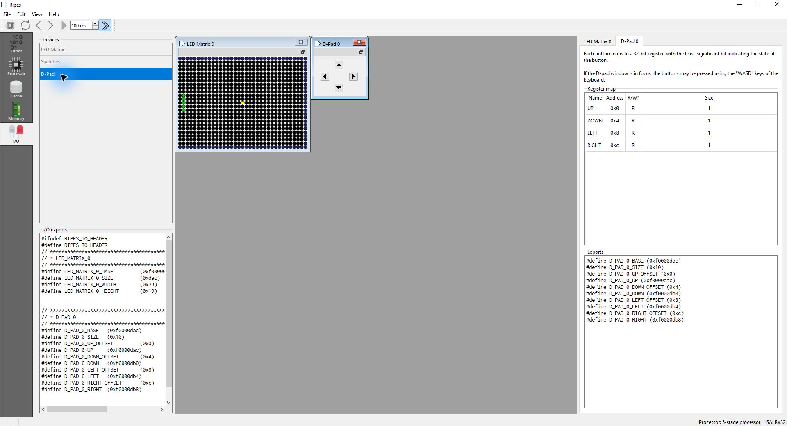
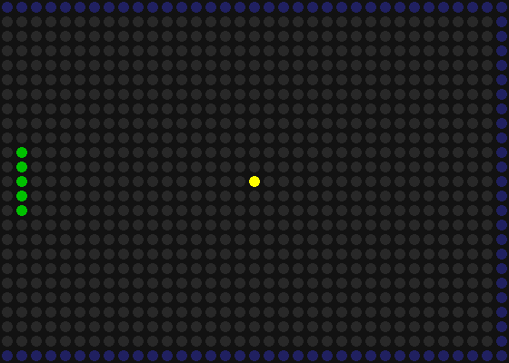

# Pong em assembly RISC-V

**Alunos:** Felipe do Prado Marques Souza e Vinicius Medeiros Peres

**Disciplina:** Arquitetura de Computadores — Universidade Católica de Santos

**Professor:** Walter S. Oliveira

Pong de um jogador para o Ripes, usando RV32I. A matriz de LEDs mostra a quadra: bordas em cima, embaixo e à direita, raquete verde na coluna 1 e bola amarela. O D-Pad move a raquete. Cada rebatida soma um ponto; se a bola passar pela raquete, a partida termina.

## Como executar

1. Selecione **Single-cycle processor**, com M e C desmarcadas. Mantenha `sp = 0x7ffffff0`.
2. Na aba **I/O**, adicione primeiro **LED Matrix**, com 35 colunas e 25 linhas, e depois **D-Pad**. Confira os endereços: matriz `0xF0000000` e D-Pad `0xF0000DAC`. Se forem diferentes, recrie os dispositivos nessa ordem ou ajuste as constantes no código.
3. Em **File → Load program**, marque **Source file** e abra [pong.s](pong.s).
4. Use **Run (F8)**, volte à aba **I/O** e clique numa seta para começar. **Cima** e **baixo** movem a raquete; as duas juntas não a movem.
5. Após o game over, a bola fica magenta. Solte os controles e pressione uma seta para reiniciar. O console fica na parte inferior da aba **Processor** e mostra a pontuação.

`DELAY = 1000` controla a espera entre quadros. Aumente o valor para deixar o jogo mais lento; use sempre um inteiro positivo.

## Exemplo de entrada e saída

Ao carregar o programa, a quadra é desenhada e o console mostra a mensagem inicial. Cada rebatida imprime a nova pontuação; quando a bola passa pela raquete, o console mostra o game over:

```text
PONG RV32I - aperte uma seta para comecar
Cima/baixo movem a raquete.
Pontos: 1
...
GAME OVER! Pontos: 3
Solte os botoes e aperte uma seta para reiniciar.
```



Partida completa executada no simulador RV32I de `testes-automaticos/` (animação gerada pelo simulador, não é captura do Ripes):



## Testes e resultados

Foram feitas 40 verificações no Ripes CLI: 20 casos em Single-cycle e os mesmos 20 em 5-stage, todos aprovados. Dez casos testam sub-rotinas e conferem a preservação de `s0`–`s11` e `sp`. Os outros dez executam um quadro do laço `jogo` original: movimento, raquete, três paredes, rebatidas com ponto, bola passando e game over. Os programas estão em [.ripes-testes/](.ripes-testes/); os [registros](docs/testes/resultados.json) e as [saídas de console](docs/testes/console.txt) ficam em `docs/testes/`. O [relatório](RELATORIO.md) explica cada caso.

[testes/testes.s](testes/testes.s) reúne 18 casos de `passo` num único arquivo que se confere sozinho. Abra-o como **Source file** e execute: o console deve mostrar `18 testes de movimento e colisao aprovados.`

A pasta [testes-automaticos/](testes-automaticos/) tem mais 34 casos, todos aprovados, e uma partida completa (rebatidas, game over e reinício), executados com o binário do `pong.s` montado pelo LLVM em RV32I num simulador em Python. O [TESTES_SIMULADOR.md](testes-automaticos/TESTES_SIMULADOR.md) explica como reproduzir.

Medições no Ripes v2.2.6-75-g183291e, em RV32I. Os números incluem a preparação, a chamada, o retorno e a saída do programa de medição:

| Teste | Instruções | Ciclos Single-cycle | Ciclos 5-stage | CPI 5-stage |
|---|---:|---:|---:|---:|
| `pixel` | 19 | 19 | 29 | 1,526 |
| `passo` | 38 | 38 | 61 | 1,605 |
| Espera, DELAY = 1000 | 9.011 | 9.011 | 13.019 | 1,445 |
| Espera, DELAY = 3000 | 27.012 | 27.012 | 39.020 | 1,445 |
| Redesenho completo | 5.229 | 5.229 | 7.509 | 1,436 |
| Quadro incremental | 299 | 299 | 413 | 1,381 |

A espera cresce na proporção de `DELAY` e domina o tempo de cada quadro. Redesenhar só os pixels móveis custa cerca de 1/17 do redesenho completo. No pipeline, desvios tomados aumentam os ciclos. O CPI sozinho não compara a velocidade física dos processadores, porque o período de clock também importa.

Para repetir, abra um arquivo de [benchmarks/](benchmarks/) como **Source file**, execute até terminar e anote **Cycles**, **Instrs. retired** e **CPI** na aba Processor. Repita com o **5-stage processor**, mantendo M e C desmarcadas.

## Arquivos

| Caminho | Conteúdo |
|---|---|
| [pong.s](pong.s) | Jogo completo |
| [RELATORIO.md](RELATORIO.md) | Funcionamento, chamadas, testes e análise |
| [benchmarks/](benchmarks/) | Sete programas curtos de medição |
| [.ripes-testes/](.ripes-testes/) | 20 programas de teste e as saídas do Ripes |
| [testes/testes.s](testes/testes.s) | 18 casos de `passo` em um único arquivo |
| [testes-automaticos/](testes-automaticos/) | 34 testes automáticos, partida completa, imagens, GIF e console |
| [docs/testes/](docs/testes/) | Capturas e registros de execução |
| [docs/desempenho/](docs/desempenho/) | Contadores e dados da compilação C |
| [c-reference/pong.c](c-reference/pong.c) | Referência em C |
| [docs/pong_compilado.s](docs/pong_compilado.s) | Saída do Clang 17.0.1 para RV32I |

A referência C usa o mesmo `DELAY = 1000` e as mesmas regras, mas não imprime mensagens no console. A comparação está no relatório.
