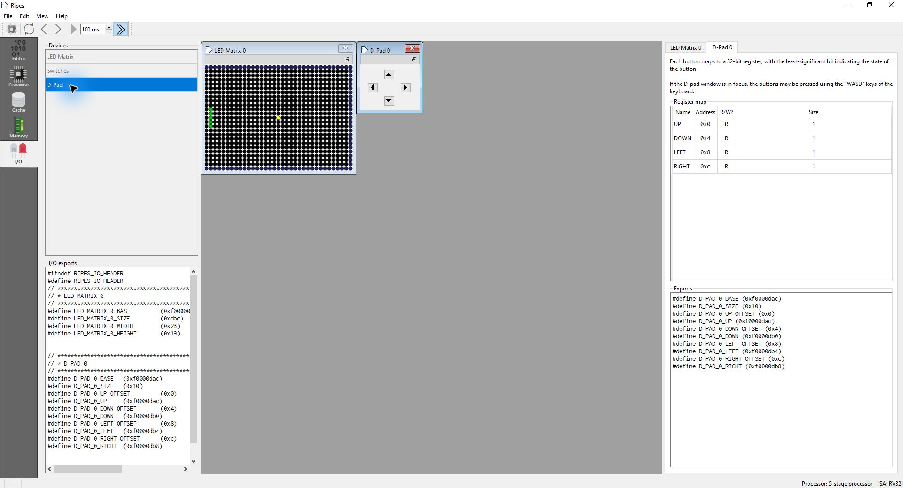
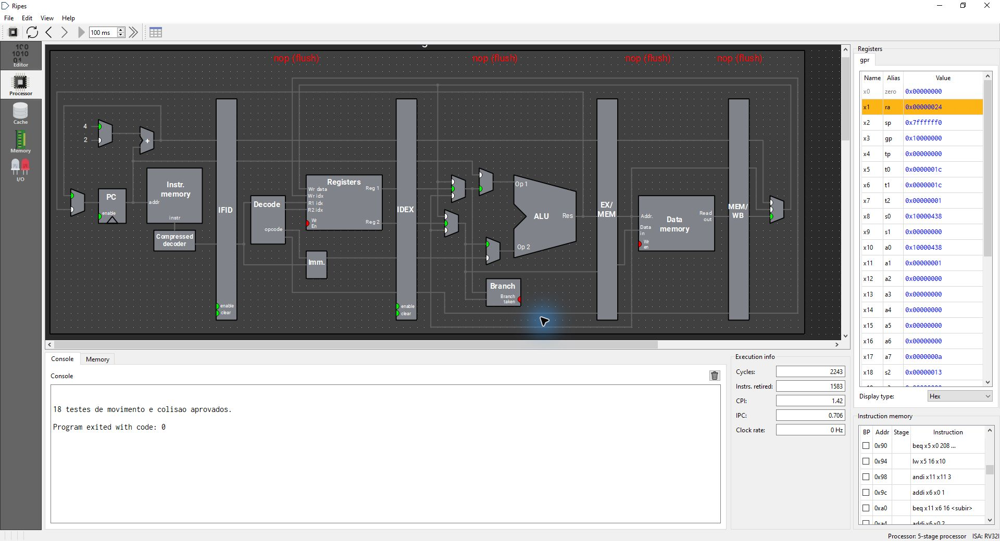
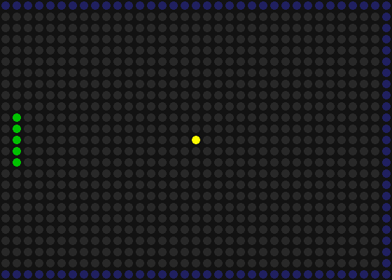
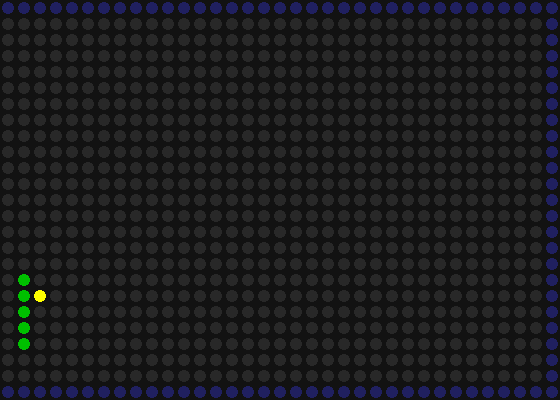
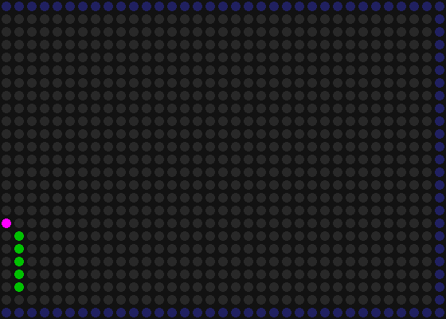
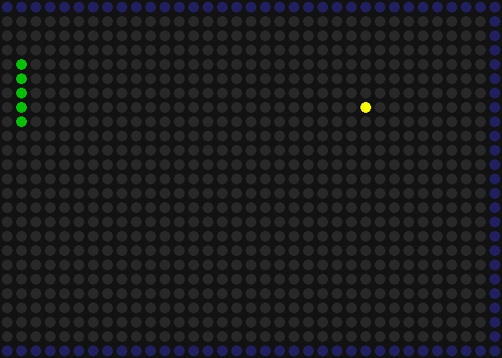

# Relatório: Pong em assembly RISC-V

Alunos: Felipe do Prado Marques Souza e Vinicius Medeiros Peres

Disciplina: Arquitetura de Computadores — Universidade Católica de Santos

Professor: Walter S. Oliveira

Simulador: Ripes v2.2.6-75-g183291e, Windows x86_64, RV32I

## 1. Objetivo e funcionamento

O projeto implementa um Pong de um jogador usando instruções RV32I, memória, sub-rotinas e periféricos do Ripes. A bola se move na diagonal pela matriz de LEDs e rebate nas bordas de cima, de baixo e da direita. O jogador defende o lado esquerdo com uma raquete de cinco LEDs. O D-Pad fornece as entradas e o console mostra a pontuação.

`main` guarda os endereços, imprime a mensagem inicial e desenha a quadra. Em `nova_partida`, o programa espera os botões serem soltos e uma seta ser pressionada. Só então restaura o estado, zera a pontuação e redesenha a tela inteira: bola em (17,12) indo para a esquerda e para baixo, raquete nas linhas 10 a 14.

Cada passagem por `jogo` faz quatro coisas:

1. Espera `DELAY` iterações lendo o D-Pad.
2. Apaga a raquete e a bola nas posições atuais.
3. Executa `passo`.
4. Pinta a raquete e a bola nas novas posições.

Se a pontuação mudou, imprime `Pontos: N`. Se a partida terminou, imprime o game over e volta a `nova_partida`.

O estado ocupa sete palavras em `.data`: `x`, `y`, `dx`, `dy`, topo da raquete, pontos e partida ativa. `passo` move a raquete entre as linhas 1 e 19 e soma `dx` e `dy` à bola. Ao passar de uma borda, a bola é refletida para dentro e a direção correspondente é invertida. Se a bola indo para a esquerda chega à coluna 1 na altura da raquete, volta para a coluna 2 indo para a direita e soma um ponto. Se chega à coluna 0, a partida termina. `passo` não acessa periféricos, o que permite testá-la só com memória.

O endereço de um LED é `base + (y*35 + x)*4`. Como RV32I não tem multiplicação, `pixel` calcula `y*35` por `y*32 + y*2 + y`, com deslocamentos e somas. São sete instruções de cálculo, uma de escrita e uma de retorno.

A tela inteira (875 LEDs) só é limpa e redesenhada por `desenhar`, no início de cada partida. Nos quadros seguintes, `apagar_moveis` e `desenhar_moveis` alteram apenas 12 LEDs: seis apagados e seis pintados. As bordas nunca são apagadas, porque a bola e a raquete não ocupam casas de borda.

## 2. Instruções e memória

| Grupo | Exemplos | Uso |
|---|---|---|
| Aritmética | `add`, `addi` | Posições, direções, pontuação e contadores |
| Lógica | `andi`, `or` | Máscaras e combinação dos botões |
| Deslocamento | `slli` | Cálculo do endereço do LED |
| Memória | `lw`, `sw` | Estado, LEDs, D-Pad e pilha |
| Desvios | `beq`, `bne`, `blt`, `bge` | Colisões, botões e laços |
| Chamadas | `jal`, `ret` | Entrada e retorno das rotinas |
| Sistema | `ecall` | Texto e pontuação no console |

`li`, `la`, `mv`, `j`, `beqz`, `bnez`, `bgtz`, `bgez`, `ble`, `bgt` e `ret` são pseudo-instruções. Por exemplo, `ble t0, t1, r` vira `bge t1, t0, r`, `bgtz t2, r` vira `blt x0, t2, r` e `ret` corresponde a `jalr x0, 0(ra)`. `li` pode precisar de uma ou duas instruções, conforme o valor.

O registrador `x0` sempre vale zero. Ele é usado para apagar LEDs, zerar pontos e o indicador de partida ativa, comparar com zero e descartar o endereço de retorno em saltos. As colisões usam comparações **com sinal**, porque `dx` e `dy` valem −1 ou +1 e a posição provisória pode chegar a zero. No Snake, `bgeu` tratava −1 como um número grande; aqui o −1 precisa continuar negativo para `bgez t3` distinguir bola indo para a esquerda.

| Região | Conteúdo |
|---|---|
| `estado`, em `.data` | 28 bytes: sete palavras do estado |
| Mensagens, em `.data` | Strings terminadas em zero |
| `0xF0000000` a `0xF0000DAB` | 875 LEDs, uma palavra `0x00RRGGBB` por casa |
| `0xF0000DAC` a `0xF0000DBB` | D-Pad: cima, baixo, esquerda e direita, offsets 0, 4, 8 e 12 |
| Pilha | Quadro de 16 bytes em `esperar_inicio` e de 32 bytes em `desenhar` e `pintar_moveis` |

## 3. Convenção de chamada

As chamadas usam `jal ra, rotina` e retornam com `ret`. Argumentos passam nos registradores `a` e resultados voltam em `a0`.

| Rotina | Entrada | Resultado |
|---|---|---|
| `iniciar_estado` | a0 = estado | Restaura as sete palavras |
| `passo` | a0 = estado, a1 = botões (bit 0 cima, bit 1 baixo) | Atualiza o estado em memória |
| `ler_botoes` | a0 = base do D-Pad | a0 = OU dos quatro botões |
| `esperar_inicio` | a0 = base do D-Pad | Espera soltar e depois pressionar uma seta |
| `esperar_controle` | a0 = base do D-Pad | a0 = último comando lido durante `DELAY` |
| `pixel` | a0 = x, a1 = y, a2 = cor, a3 = base dos LEDs | Pinta um LED |
| `desenhar` | a0 = estado, a1 = base dos LEDs | Limpa a tela e pinta bordas, raquete e bola |
| `apagar_moveis` / `desenhar_moveis` | a0 = estado, a1 = base dos LEDs | Apaga ou pinta só a raquete e a bola |

`main` mantém em `s0`–`s4` o endereço do estado, a base dos LEDs, a base do D-Pad, a última pontuação impressa e o comando lido no quadro. `main` não retorna. Se a pontuação em memória difere de `s3`, o laço imprime o novo valor.

`passo`, `pixel`, `ler_botoes`, `esperar_controle` e `iniciar_estado` são folhas: não chamam outras rotinas e usam apenas registradores `a` e `t`. `esperar_inicio`, `desenhar` e `pintar_moveis` chamam outras rotinas. Por isso salvam `ra` e os registradores `s` que usam, e restauram `sp` no retorno. `desenhar` termina com `j desenhar_moveis`, uma chamada de cauda: já restaurou a pilha e passa adiante o `ra` original. Os registradores `a` e `t` são temporários; quem chama não deve esperar que sejam preservados.

`apagar_moveis` e `desenhar_moveis` são dois pontos de entrada da mesma rotina `pintar_moveis`. Eles só diferem no indicador em `a2` (0 apaga, 1 pinta), o que evita duplicar o laço da raquete.

## 4. Entrada e saída

Qualquer seta inicia a partida. Durante o jogo, **cima** e **baixo** movem a raquete; esquerda e direita são ignoradas. Durante a espera, os botões são consultados a cada iteração e o último comando não nulo é guardado. Assim, um toque curto não se perde. Cima e baixo juntos produzem o valor 3, que `passo` ignora.

Verde indica a raquete, amarelo a bola e azul-escuro (`0x202060`) as bordas. No game over, a bola fica magenta na coluna 0 e permanece assim até a próxima partida.

Mensagens do console registradas nos casos controlados e na execução do programa completo:

```text
PONG RV32I - aperte uma seta para comecar
Cima/baixo movem a raquete.
Pontos: 1
...
GAME OVER! Pontos: 3
Solte os botoes e aperte uma seta para reiniciar.
```

## 5. Testes e evidências

### Interface do Ripes

O programa completo foi carregado como **Source file**, com RV32I e `DELAY = 1000`. A captura abaixo mostra a quadra desenhada no início: raquete verde na coluna 1, linhas 10 a 14, e bola amarela em (17,12).



A verificação dos 18 casos de `passo` também foi executada pela interface, no processador 5-stage. O console mostrou `18 testes de movimento e colisao aprovados.`, com 1583 instruções e 2243 ciclos.



Ainda não há capturas do Ripes de uma partida interativa. A partida completa (rebatidas, game over magenta e reinício) foi executada no simulador descrito em "Partida completa e testes automáticos", abaixo. Para testar pela interface, inicie uma partida, mova a raquete até a bola e rebata, deixe a bola passar e reinicie. Confira a pontuação no console e as cores em cada etapa.

### Casos controlados

Foram executadas 40 verificações no Ripes CLI: 20 casos em Single-cycle e os mesmos 20 em 5-stage. Os [registros](docs/testes/resultados.json) guardam descrição, valores esperados, registradores finais e saída do simulador de cada execução. As [saídas de console](docs/testes/console.txt) incluem pontuação e game over. Os programas de teste ficam em [.ripes-testes/](.ripes-testes/) e podem ser abertos no Ripes.

Esses casos usaram LEDs e D-Pad representados em RAM, com entradas fixas. As sub-rotinas vêm do próprio `pong.s`.

**Dez casos verificaram sub-rotinas.** Antes da chamada, `s0`–`s11` recebem os valores 101 a 112. Depois, o teste confere esses valores e `sp = 0x7ffffff0`.

| Caso | Verifica |
|---|---|
| `pixel_primeiro`, `pixel_ultimo` | Endereço de (0,0) e de (34,24), sem multiplicação |
| `iniciar_estado` | Estado restaurado a partir de valores arbitrários |
| `botoes_soltos`, `botao_direita` | `ler_botoes` com D-Pad solto e com a seta direita (offset 12) |
| `controle_cima`, `controle_dois_botoes` | `esperar_controle` devolve 1 e, com cima e baixo, 3 |
| `desenhar_tela` | Tela cheia de lixo é limpa; bordas, raquete e bola pintadas |
| `apagar_moveis` | Raquete e bola apagadas, bordas intactas |
| `bola_magenta` | Com a partida encerrada, a bola é pintada de magenta |

**Dez casos executaram um quadro do laço `jogo` original** em estados preparados, depois de desenhar a tela com `desenhar`. O laço foi copiado de `pong.s`. Só os saltos para continuar (`bnez t0, jogo`) ou reiniciar (`j nova_partida`) foram trocados pela coleta do resultado. Cada caso confere as sete palavras do estado e quatro LEDs.

| Caso | Situação | Resultado esperado e obtido |
|---|---|---|
| `passo_livre` | Sem botões | Bola em (16,13); LED antigo apagado |
| `raquete_sobe` / `raquete_desce` | Cima / baixo | Raquete em 9 / 11; LED da ponta oposta apagado |
| `parede_cima`, `parede_baixo`, `parede_direita` | Bola na borda | Bola refletida e direção invertida; borda intacta |
| `rebatida_centro` | Bola em (2,11), raquete 10–14 | Bola em (2,12) indo para a direita; `Pontos: 1` |
| `rebatida_ponta` | Bola atinge a última linha da raquete | `Pontos: 3`, a partir de 2 |
| `bola_passa` | Bola acima da raquete | Bola em (1,9), partida ainda ativa |
| `game_over` | Bola em (1,8), raquete 10–14 | Bola magenta em (0,9); `GAME OVER! Pontos: 3` |

Para conferir se os testes detectam erros, a comparação da última linha da raquete foi alterada numa cópia do código (`addi t5, t0, 4` → `3`). A bateria falhou no caso `rebatida_ponta`.

Além disso, [testes/testes.s](testes/testes.s) reúne em um único arquivo 18 casos de `passo`. Abra-o como Source file e execute; o próprio programa compara os resultados e imprime a aprovação ou o número do caso que falhou. Os 18 casos passaram nos dois processadores.

### Partida completa e testes automáticos

Esta bateria complementa os testes do Ripes e está toda em [testes-automaticos/](testes-automaticos/). O `pong.s` foi montado **sem alterações** pelo assembler do LLVM (`clang --target=riscv32 -march=rv32i`), com o mesmo mapa de memória do Ripes: `.text` em `0x00000000`, `.data` em `0x10000000`, `sp = 0x7ffffff0`, LEDs em `0xF0000000` e D-Pad em `0xF0000DAC`. O binário foi executado num simulador RV32I em Python ([rv32i.py](testes-automaticos/rv32i.py)), que decodifica as instruções de máquina e implementa as ecalls 1, 4 e 10. O assembler aceitar o programa com `-march=rv32i` confirma que ele não usa as extensões M ou C.

**34 casos aprovados** ([testes_pong.py](testes-automaticos/testes_pong.py), [resultados](testes-automaticos/resultados_testes.json)). Todos conferem `s0`–`s11` (101 a 112) e `sp` depois do retorno:

- 20 casos de `passo`: movimento livre; raquete sobe, desce, cima e baixo juntos, limites 1 e 19; as três paredes e o canto superior direito; rebatida no centro, na primeira e na última linha da raquete; bola passando acima e abaixo; game over; partida encerrada sem mudança; bola indo para a direita na coluna 1; rebatida junto com reflexo na parede; raquete movendo e rebatendo no mesmo quadro.
- 3 casos de `pixel`, 6 de botões (`ler_botoes` e `esperar_controle`), 4 de desenho e estado.
- 1 mutação: com `addi t5, t0, 4` trocado por `3`, o caso da última linha da raquete falha, como esperado.

**Partida completa** ([partida.py](testes-automaticos/partida.py)). O programa roda a partir de `main` com `DELAY = 1000`. Um jogador automático aperta a seta direita para começar e usa cima/baixo para seguir a bola; depois de 3 pontos, tenta se afastar para perder. Após o game over, solta os botões, aperta uma seta e joga uma segunda partida. Foram 3.174.959 instruções em 324 quadros. Console registrado ([console_partida.txt](testes-automaticos/console_partida.txt)):

```text
PONG RV32I - aperte uma seta para comecar
Cima/baixo movem a raquete.
Pontos: 1
Pontos: 2
Pontos: 3
Pontos: 4
GAME OVER! Pontos: 4
Solte os botoes e aperte uma seta para reiniciar.
Pontos: 1
```

As imagens abaixo foram geradas a partir da matriz de LEDs simulada; **não são capturas de tela do Ripes**. A animação da partida inteira está em [partida.gif](testes-automaticos/partida.gif).

| Início | Rebatida (Pontos: 1) | Game over | Segunda partida |
|---|---|---|---|
|  |  |  |  |

### Vídeo

Não há gravação em vídeo do Ripes desta versão. A animação [partida.gif](testes-automaticos/partida.gif), gerada no simulador, mostra uma partida completa.

## 6. Análise arquitetural

### Procedimento

Os arquivos de [benchmarks/](benchmarks/) podem ser abertos diretamente no Ripes. Cada programa prepara os argumentos, executa um trecho e termina com `ecall 10`. As medições usam RV32I, sem M/C, em **Single-cycle** e **5-stage com forwarding e detecção de hazards**.

Carregue um arquivo como Source file, execute até terminar e anote Cycles, Instrs. retired e CPI na aba Processor. Troque o processador e execute novamente desde o início. No teste de espera, os quatro valores do D-Pad estão zerados em RAM, representando botões soltos.

Os contadores incluem preparação, chamada, retorno e saída. Não são os ciclos de uma partida nem somente o corpo da rotina. Os valores brutos estão em [resultados.json](docs/desempenho/resultados.json).

| Programa | Instruções | Ciclos Single-cycle | CPI Single-cycle | Ciclos 5-stage | CPI 5-stage |
|---|---:|---:|---:|---:|---:|
| `pixel_base.s`, sem chamada | 9 | 9 | 1 | 15 | 1,667 |
| `pixel.s` | 19 | 19 | 1 | 29 | 1,526 |
| `passo.s`, sem colisão | 38 | 38 | 1 | 61 | 1,605 |
| `espera_1000.s` | 9.011 | 9.011 | 1 | 13.019 | 1,445 |
| `espera_3000.s` | 27.012 | 27.012 | 1 | 39.020 | 1,445 |
| `quadro_completo.s` | 5.229 | 5.229 | 1 | 7.509 | 1,436 |
| `quadro_incremental.s` | 299 | 299 | 1 | 413 | 1,381 |

### Interpretação

No cálculo do endereço, a diferença para o programa base é de dez instruções: sete de cálculo, `sw`, `jal` e `ret`. O custo adicional é de dez ciclos no Single-cycle e catorze no pipeline. Os dois saltos incondicionais descartam instruções já buscadas.

Sem botão pressionado, cada volta de `esperar_controle` executa nove instruções. Ao mudar DELAY de 1000 para 3000, o total aumenta em 18.001 instruções e 26.001 ciclos no 5-stage, ou seja, nove instruções e 13 ciclos por volta adicional. Os quatro ciclos extras vêm dos dois desvios tomados por volta, `beqz` (nenhum botão) e `bnez` (volta ao início), cada um com duas instruções descartadas. As duas leituras do D-Pad vêm antes dos dois `andi` que usam seus valores, por isso não há parada por dependência de carga. A unidade extra ocorre porque carregar 3000 com `li` exige duas instruções (`lui` e `addi`), enquanto 1000 cabe no imediato de 12 bits.

Por isso o CPI da espera do Pong (1,445) fica bem abaixo do CPI da espera do Snake (2,272). O Snake testa cada botão logo após lê-lo, o que provoca uma parada a cada leitura, e tem cinco desvios tomados por volta.

O redesenho incremental reduz o trabalho de desenho de cada quadro de 5.229 para 299 instruções, já incluindo o `passo` e a preparação. Somando as medições, um quadro com DELAY = 1000 passa de cerca de 14.300 para cerca de 9.300 instruções. Com o mesmo DELAY, isso dá aproximadamente 1,5 vez mais quadros por segundo do que a versão que limpava a tela toda. É uma estimativa feita com os trechos medidos, não uma medição de partida inteira. Também deixa de existir o instante em que a matriz fica toda apagada, que podia causar cintilação.

Os laços são simples, sem desenrolamento. O CPI não basta para afirmar qual processador físico seria mais rápido: também seria necessário considerar o período de clock.

## 7. Referência em C

[pong.c](c-reference/pong.c) é uma referência para comparar o código gerado. C e assembly usam `DELAY = 1000`, o mesmo estado, as mesmas regras de colisão e o mesmo redesenho incremental. O C não reproduz as mensagens do console.

A saída em [pong_compilado.s](docs/pong_compilado.s) foi gerada no Compiler Explorer com Clang 17.0.1 para RISC-V 32 bits e as opções:

```text
-O2 -march=rv32i -mabi=ilp32 -ffreestanding -g0 -fno-verbose-asm
```

Os [dados da compilação](docs/desempenho/compilacao-c.json) registram a versão e a conclusão sem erros. O Clang inlinou todas as funções em `main`. A saída tem seis chamadas a `__mulsi3`, a multiplicação em software: duas multiplicam `y` por 35 para a bola e quatro multiplicam `y` por 140 (35 × 4 bytes) para o laço da raquete. No assembly do jogo, `pixel` faz o mesmo cálculo com três deslocamentos e quatro somas, sem chamada auxiliar.

Essa comparação é estática. Não foram medidos aqui os ciclos de `__mulsi3` nem uma partida completa em C contra assembly.

## 8. Limites da verificação

O programa completo foi montado e executado no Ripes até a espera pela primeira seta, e os 20 casos controlados passaram nos dois modelos. As medições mostram o custo do cálculo de endereço, da espera e do redesenho. Não houve teste em hardware físico. A partida completa, com rebatidas, game over e reinício, foi executada no simulador RV32I de `testes-automaticos/`, e os 34 casos de lá passaram. Faltam capturas do Ripes de uma partida interativa: as capturas do Ripes mostram a tela inicial e os testes de `passo`.
